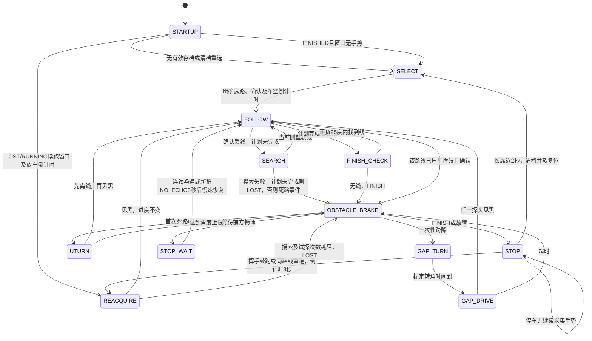

# Pico 巡线固件

面向 Raspberry Pi Pico / MicroPython。四张地图的程序和参数在赛前一次写入，无存档时用前超声手势选路，有有效存档时可按原进度续跑；不修改代码换图。上传与接线入口见 [robot_setup.md](../robot_setup.md)，比赛当天使用 [RUNBOOK.md](RUNBOOK.md)。这里说明控制行为、标定和完整参数。

当前交付包含主机模拟测试；转角、供电和实车路线仍须上车验证。本文的角度来自时间估算，没有编码器或自动角度测量。

## 文件与接口

赛前上传以下 **8 个运行文件**到 Pico 文件系统根目录，`main.py` 最后上传：

| 文件 | 功能 |
|---|---|
| [main.py](main.py) | 单一控制状态机，开机选路和约 1 ms 协作主循环 |
| [config.py](config.py) | 集中的标定参数、行为参数和路线表 |
| [motor.py](motor.py) | 有符号驱动、死区映射、补偿、软启动、主动刹车 |
| [ir_sensors.py](ir_sensors.py) | GP14/15，5 ms 采样与连续读数确认 |
| [ultrasonic.py](ultrasonic.py) | 前/左异步 Echo IRQ、F/F/L 调度与前方中位数 |
| [route_select.py](route_select.py) | 选路/存档续跑手势状态机与 LED 反馈 |
| [power.py](power.py) | 标准 Pico 的 VSYS / USB 检测与有界补偿 |
| [run_state.py](run_state.py) | key=value进度存档、校验和原子替换 |

按需另传 [calibrate.py](calibrate.py)、[ir_calibration.py](ir_calibration.py)，标定完成后恢复运行 `main.py`。`tests/`、`typings/` 和编辑器配置留在电脑上。

`motor.init_motors()` 初始化为停止；`drive(left, right, brake_zero=False)` 接收 −100…100 的有符号**指令**；`motor.update(now)` 推进软启动；`brake()` 将两路 IN 置 1、EN 置满占空比；`stop()` 关闭两路。轮子方向由 `config.LEFT_REVERSED` / `RIGHT_REVERSED` 控制，调参应修改 `config.py`。正指令必须对应车体前进，抬轮检查后再落地。标定值不等于测得的速度。

非零指令先乘电压补偿，再线性映射到 `[MIN_DRIVE_PERCENT, 100]` 并限幅；0 仍为 0。`INNER_MODE` 可选 `COAST`、`BRAKE`、`REVERSE`。起步/换向的 `SOFT_START_MS` 爬升由主循环更新，`brake()`、`stop()` 立即生效。停车与原地转向前的 `BRAKE_MS` 等待由状态机计时，控制handler不用sleep；事件存档会短暂阻塞，须用菜单6实测耗时。异常及 Ctrl+C 的退出清理调用 `motor.stop()`。

## IR 约定与安装高度

**黑胶带 = 1，背景 = 0；车身居中时两个探头都在胶带内。** `BOTH_BLACK` 不能单独证明遇到了交叉，`NO_LINE` 也不能单独证明到终点。

| 左、右 raw | 状态 | CENTER 行为 |
|---|---|---|
| 1, 1 | `BOTH_BLACK` | 居中直行，十字交叉也直行 |
| 1, 0 | `LINE_LEFT` | 车偏右，向左纠偏 |
| 0, 1 | `LINE_RIGHT` | 车偏左，向右纠偏 |
| 0, 0 | `NO_LINE` | 按路线执行终点检查或有界搜索 |
| 尚未确认 | `UNSTABLE` | 暂停驱动 |

以下尺寸是**安装起始值，以实测为准**：

- IR 底面距地面 **5–8 mm，目标约 6 mm**，垂直向下，装在驱动轮轴前 **4–6 cm**。
- 探头中心距约为胶带宽度减 **6–8 mm**；19 mm 胶带约用 **11–13 mm**，居中时距两侧边缘各留至少 **3 mm**。
- 检查 3 号坡脚/坡顶与 4 号泡沫/木板台阶：不刮地，探头高度始终在 **3–12 mm** 范围。
- 电位器优先按最差对比度组合调整：灰色反光胶带/红坡面、黑胶带/蓝泡沫，再复查白底、木板、绿坡面。黑、灰胶带均应稳定读 1，所用背景应稳定读 0；调整后检查两只探头。
- 前 HC-SR04 换能器中心离地 **2–3 cm**，板下沿约 **1 cm**，位于车头最前端，水平或上仰 **3–5°**。矮块不足 2 cm 高时，将中心进一步降至约 **2 cm**。
- 用 `ultrasonic.py` 或标定菜单 4 验收：4 号矮块距 **10–30 cm** 时持续 `VALID`；空地板前方应 `NO_ECHO` 或 **>40 cm**；3 号坡脚读数应 **≥12 cm**，否则尝试增加上仰角并重新检查矮块。
- 左超声可与前超声同高，作为侧向距离信息；路线固定动作由路线表指定。

## 四条路线

`ROUTES` 完整默认值如下；`base_speed` 覆盖全局 `BASE_SPEED_PERCENT`。路线 0 仅供主机/台架调试，手势只能选 1–4。

| 编号 | follow | turns | finish | dead_ends | obstacle | obstacle_after_turns | base_speed | creep_on_loss_ms | checkpoints |
|---|---|---|---|---|---|---|---|---|---|
| 0 | CENTER | 空 | DEAD_END | FINISH | STOP_WAIT | 0 | 55 | 0 | [] |
| 1 | CENTER | RRR | AFTER_TURNS | FINISH | NONE | 0 | 60 | 0 | [] |
| 2 | CENTER | RRRLLRRRRR | AFTER_TURNS | FINISH | NONE | 0 | 55 | 0 | [] |
| 3 | CENTER | LLR | DEAD_END | FINISH | GAP_LEFT | 3 | 55 | 0 | [] |
| 4 | EDGE_RIGHT | 空 | DEAD_END | UTURN, FINISH | DEAD_END | 0 | 50 | 0 | [] |

1. **矩形**：完成 R/R/R 后，下一次确认丢线进入小角度终点检查，找不到线则刹车并锁存 STOP。
2. **直角迷宫**：按十个转角执行；四次十字保持直行。计划用完后仅在原航向左右 **各 25°** 内检查，不做 110° 搜索，避免约 110° 重新抓到底边。找到线则恢复，否则停车。此处采用已确认的 ±25° 终点检查。
3. **坡道、墙和间隙**：三个转角 L/L/R 之前完全忽略前超声，既不停车也不减速；之后前方墙确认触发刹车、左转约 60°、斜穿间隙。任一探头重新见黑即恢复；直行超时锁存 STOP。跨隙动作只用一次，之后障碍行为转为 STOP_WAIT；末端按死路事件 FINISH。
4. **arm**：默认右沿巡线，J1 进第一条腿，障碍或线尾消耗同一个 UTURN 队列项；先离线再见黑结束掉头，回 J1 右转上第二拱，J2 进中腿，第二次死路 FINISH。赛前可把 follow 改为 `EDGE_LEFT`，按左手路线经过第三条腿掉头后回中腿；赛中不改参数。

`EDGE_RIGHT`：11 缓右、10 缓左、01 急右；00 丢线时，上个确认状态为 `LINE_LEFT` 才先向左，否则先右。`EDGE_LEFT` 镜像；缓转内轮乘 `EDGE_INNER_RATIO`，急转内轮按 `INNER_MODE`。

3 号灰胶带应先用电位器调到黑；实在无法稳定检测才在赛前启用 `creep_on_loss_ms`。仅第一个转角前、且没有最近单侧方向时，短直行找线；到上限仍未找到则等时倒退，再搜索。默认 0，关闭。

## 控制与传感器时序

主循环更新 power、motor、异步 sonar；IR 每 5 ms 采样，默认三个同样读数确认。所有控制计时使用 `ticks_diff`，角度用 `deg_to_ms()`，跨时钟回绕也按差值处理。

搜索用等速反向轮指令真正原地转：首选侧最多 110°，再反向最多 220°。计划方向优先于最近 raw 单侧方向；没有计划才考虑最近 150 ms 的 raw 记录，再退回默认方向。仅在计划方向侧重获线且累计转向至少 25°时消耗一个转角；直道短暂出界不会自动消耗计划。扫描只接受当前扫描侧或两侧见黑，忽略对侧单独见黑。重置跟踪时清除旧方向记忆。

通常障碍需要两个不同 `sample_ms` 的连续 VALID 中位数读数都≤12 cm，≤25 cm时减速。**仅在已启用障碍的路段**，一个新鲜 `VALID≤25 cm` 会留下500 ms的接近记忆；这段时间内的新 `NO_ECHO` 或 `<2.5 cm` 盲区无效读数会立即锁存障碍，执行该路线动作。这是“接近后突然失去回波”的例外，不再等第二个VALID读数，避免近到盲区后继续前冲。孤立的 `<2.5 cm` 仍是无效距离，不能单独证明障碍或畅通；没有近期接近记录/锁存时，`NO_ECHO` 允许空旷场地继续行驶。路线1/2全程、路线3前三弯仍完全忽略这些障碍策略。

接近记忆过期后不再用它升级新的盲区读数；已经锁存的障碍不会仅因500 ms过去而解除。新的 `VALID>25+5=30 cm`、完成UTURN、完成GAP_TURN，或已完成机动的累计原地转向达到45°会清除旧朝向的接近锁存。上述角度均由标定时间估算。

F/F/L 每个时隙至少相隔70 ms，前方有效读数取三点中位数，因此确认仍有延迟，停止距离须实测。`PENDING`=未测到、`STALE`=超龄、`NO_ECHO`=未收到完整回波。对启用障碍的路线，FOLLOW遇PENDING/STALE暂停等待；机动中不因此打断。NO_ECHO也可能来自断线，不能替代传感器验收。

STOP_WAIT通常在连续新鲜畅通读数持续 `CLEAR_HOLD_MS`（500 ms）后继续。**已有接近锁存时，VALID为13–30 cm仍不能恢复**；必须先有新的 `VALID>30 cm` 清除锁存，再满足500 ms畅通保持。若只剩持续的新鲜NO_ECHO，则等待 `STOP_WAIT_NO_ECHO_MS`（3 s），解除锁存，并以不高于 `SLOW_SPEED_PERCENT` 的速度恢复巡线 `RECOVERY_SLOW_MS`（1 s），之后回到正常速度。中途非NO_ECHO、超龄或测量断档会打断这3 s计时。

UTURN必须先离开原线再见黑，角度上限220°；完成后短暂忽略障碍。GAP_DRIVE、UTURN等以传感器事件提前结束，时间仅作上限（名义机动允许 `MANEUVER_TIME_MARGIN`，搜索/掉头硬角度上限仍有效）。**GAP_TURN是时序例外**：没有航向传感器，60°指令使用 `deg_to_ms(GAP_TURN_DEG)` 的标定时间上限；有满足条件的重获线事件可提前结束，否则在已离线的前提下到时进入GAP_DRIVE。没有测得角度反馈，不能保证实际转过60°，必须上车调整。



FOLLOW中的WAIT_FRONT是停止输出的等待行为。STOP保持电机停止并继续处理手势，恢复方式见下节；同时接着USB与电池时，仅拔掉一路不一定断电。DEBUG日志按状态变化输出，间隔至少50ms。

## 停车与断电续跑

`run_state.txt`由Pico在运行时生成，不需要从电脑上传。使用简单的`key=value`文本，字段为`route`、`turn_index`、`dead_end_idx`、`gap_used`、`status`、`stop_reason`、`seq`。`seq`每次保存递增；先完整写`run_state.tmp`，再rename替换正式文件，损坏/缺字段/非法进度按无存档处理。

写入时机：选路确认且出发前保存RUNNING、进度清零；锁存STOP先刹车停稳再保存LOST或FINISHED；默认`SAVE_ON_EVENTS=True`还会在转角索引、死路队列位置或跨隙标志变化时保存。FINISH_CHECK判终点或消费FINISH项对应FINISHED，其余锁存STOP为LOST。意外掉电时仍标为RUNNING的有效存档，上电按LOST恢复。复位不会自动清空已保存的路线进度。

计划转角尚未完成时，有界搜索失败保存`LOST/SEARCH_FAIL`，不会提前消费终点项。行驶后进入STOP，先停稳1s，再看到一次新鲜净空读数才接受手势；手势后的3s放车倒计时也要求持续净空，未知或过期读数会重新计时。

| 场景 | 操作与结果 |
|---|---|
| 无有效存档 | 原来的手势选1–4，未选择就不出发 |
| 上电有LOST或RUNNING存档 | LED双闪循环，4s续跑窗口内不操作则沿原路线、原进度续跑；随后核号慢闪及5s放车倒计时 |
| 上电有FINISHED存档 | LED三闪循环；窗口内无手势则正常选路，开始新一轮 |
| 续跑窗口挥1次 | 按存档进度续跑；FINISHED时只撤销最后一次FINISH队列消费，AFTER_TURNS路线转角进度不变 |
| 续跑窗口挥2次 | 同一路线从头开始，进度清零；放回START |
| 续跑窗口贴近2s | 删除存档，回正常选路 |
| STOP期间 | 停稳至少1s后接受手势；挥1次续跑、挥2次同路线从头开始，均经3s常亮放车倒计时进入REACQUIRE；贴近2s清档并软复位选路 |

续跑会清空旧方向记忆、清除障碍锁存，并在`OBSTACLE_IGNORE_MS`内忽略前超声。**放回丢线处附近的同一物理线段，车头朝原来的行驶方向**；没有编码器或定位，放到另一段线会让转角计划错位。想回起点应挥2次从头开始。FINISHED挥1次适用于终点误判，不应当作新一轮发车。

REACQUIRE仅负责重新找线：任一探头已见黑则直接FOLLOW；否则按默认侧有界原地搜索，未找到就以`REACQUIRE_CREEP_PERCENT`直行试探最多`REACQUIRE_CREEP_MS`，再搜索，最多`REACQUIRE_TRIES`轮。过程中见黑立即恢复；耗尽则以`REACQUIRE_FAIL`保存LOST并停车。**整个REACQUIRE不推进转角、不弹出死路项、不改变gap_used；它的搜索失败不算死路事件。** 找到线后第一次正常丢线才继续使用原转角计划。

每条路线的`checkpoints`默认空列表，由队伍按实测填写`(name, turn_index, dead_end_idx, gap_used)`，不要猜测地图进度。非空时续跑窗口挥3次，选择转角索引不超过存档的最后一个检查点；空列表时3次为无效手势并报错。仍须把车放到对应检查点的线段与方向。

闪存写入会阻塞主循环。赛前在Pico上运行`calibrate.py`菜单6，默认做5次完整原子存档写入，打印平均/最长耗时；专用`run_state_benchmark.txt`及其临时文件会在测试后清除，正式比赛存档保持不变。平均耗时>40ms时，赛前将`SAVE_ON_EVENTS=False`，仅在选路确认和停车时保存；此时拔电源前必须确认车已停稳并完成存档，运行中掉电可能恢复到旧进度。主机测试时钟是模拟值，本文**没有Pico实测写入耗时**；需真机测量后记录，不能用电脑耗时代替闪存延迟。

## 标定步骤与供电

1. 抬轮确认电机方向、共地、ENA/ENB 跳线已拔及 Echo 分压，再用低速确认纠偏方向。
2. 运行 `ir_calibration.py` 或 `calibrate.main()` 菜单 3，每 200 ms 检查 raw 值。逐一测试蓝泡沫、木板、红/绿坡面、白底和灰色反光胶带；不改变黑=1约定。
3. 菜单 4 检查前/左超声；按上述安装高度验收矮块、空地板和坡脚。菜单 5 打印 VSYS/USB/补偿状态；USB 接入时该电压不代表电池工作点。
4. **菜单 2：原始占空比起步测试。** 车轮悬空，从 20% 起每次加 5%，每次驱动默认 2 s，停止默认 1 s；可在菜单限制最高测试值。观察首先能可靠起步的档位，按该档位与轮子实际负载复测 `MIN_DRIVE_PERCENT`。工具临时关闭最小值映射、电压补偿、软启动，保留 trim；若标定时 trim 不为 1，要结合记录解释实际左右 duty。每档前 LED 闪 N 次，档位=20+(N−1)×5；这不是自动测到的起步阈值。
5. **菜单 1：原地转 360° 检查。** 在足够空旷平面上标记初始方向，按 `PIVOT_MS_PER_90×4` 时间驱动。肉眼/视频量实际转角；若转过 θ 度，用 `新值=旧值×360/θ` 估算，再复测。无法测角时逐步调小/调大，不把名义360°记成实测结果。
6. 必须上车标定 **`PIVOT_MS_PER_90`、`MIN_DRIVE_PERCENT`、`GAP_TURN_DEG`、`OBSTACLE_STOP_CM`、`EDGE_INNER_RATIO`**；分别检查三个表面上的转角/负载、3号斜跨截线、真实制动距离、4号分岔。本文所有默认速度和时间均为起始值。

菜单 1/2 的电机标定必须使用**电池独立供电**。先接电池，在 USB REPL 选择动作，工具亮 LED 倒计时 `START_DELAY_MS`（默认5s），在此期间拔掉 USB。工具再等待电压窗口刷新；如果 USB 仍连接则拒绝启动。拔 USB 后没有实时 REPL，程序继续自行运行。动作完成后重新插 USB，在 REPL 读取：

```python
print(open("calibration_last.txt").read())
```

该小文件保留最后一次测试、参数、动作阶段 `vsys_avg`/`vsys_min`、USB状态及完成/故障信息；被下次动作测试覆盖。完成 LED 慢闪3次后常亮，故障快闪10次后熄灭。观察机械动作并记录结果，选取对应工作点的电池 VSYS 作为 `VSYS_REF`，再以这个参考电压复测转角。工具不自动修改配置，也不测量真实角度/起步阈值。USB 在动作中重新接入会中止测试。强制掉电/复位可能来不及写结果；无文件不能推断完成。标定后电池电量、轮胎、地面或负载变化都应重新检查。

标准 Pico 用 GP29 的 16 次分散采样平均测 VSYS，每 200 ms 更新；GP24 判断 USB。电池且启用补偿时 `factor=clamp(VSYS_REF/vsys,0.85,1.35)`，USB 时固定1；Pico W 禁用该补偿并提示；由于USB检测也不可用，工具拒绝无法确认电池独立供电的电机标定，可先用静态诊断并以外部仪表标定供电。软启动可降低电流尖峰，但**约4V的供电不能靠软件升成稳定5V**；HC-SR04 低压失效、L298N压降或带载掉电仍需实测，固定4×AA的条件下先降低速度、减小机械负载并检查接线。补偿不是稳压器，也不能保证所有电量下保持转角。

## config.py 完整参数默认值

以下表按 `config.py` 顶层常量列出；该文件为唯一调参入口。固定硬件引用不应改动。`ROUTES` 的完整默认值见上面的路线表。参数值与代码相同，注释说明保留源文件原文，便于逐项对照。

<!-- CONFIG_TABLE_START -->
| 参数 | 默认值 | 含义 / 标定提示 |
|---|---|---|
| `PWM_FREQUENCY` | `1000` | PWM frequency in Hz; keep fixed during motor calibration. |
| `LEFT_REVERSED` | `False` | Raise wheels and set True if positive left drive is backward. |
| `RIGHT_REVERSED` | `False` | Raise wheels and set True if positive right drive is backward. |
| `LEFT_TRIM` | `1.0` | Reduce the faster wheel's multiplier after a straight-line test. |
| `RIGHT_TRIM` | `1.0` | Reduce the faster wheel's multiplier after a straight-line test. |
| `MIN_DRIVE_PERCENT` | `35` | Reliable starting duty floor; find it with calibrate.py. |
| `PIVOT_SPEED_PERCENT` | `50` | Signed equal-wheel pivot command used for angle calibration. |
| `PIVOT_MS_PER_90` | `500` | Placeholder: measure a 90-degree pivot at the configured speed. |
| `VSYS_REF` | `4.0` | Placeholder: record battery VSYS during pivot/dead-zone calibration. |
| `VSYS_LOW` | `3.6` | Low-voltage warning threshold; verify under motor load. |
| `ADC_REFERENCE_V` | `3.3` | ADC reference voltage; refine against a meter if required. |
| `VSYS_DIVIDER` | `3.0` | Standard Pico GP29 VSYS divider ratio; do not change wiring. |
| `VOLT_COMP_MIN` | `0.85` | Minimum correction factor for voltage above the reference. |
| `VOLT_COMP_MAX` | `1.35` | Maximum correction factor; verify motor current at low battery. |
| `VOLT_COMP` | `True` | Enable bounded voltage compensation on standard Pico battery power. |
| `SOFT_START` | `True` | Ramp starts and reversals to reduce supply-current spikes. |
| `SOFT_START_MS` | `40` | Startup ramp duration; confirm a smooth start without stalls. |
| `POWER_UPDATE_MS` | `200` | Voltage averaging window; check battery sag in the serial log. |
| `POWER_SAMPLES` | `16` | ADC samples spread across a voltage window; never burst-read in control. |
| `BRAKE_MS` | `60` | Active-brake pause before stops or pivot direction changes. |
| `INNER_MODE` | `'COAST'` | COAST/BRAKE/REVERSE; compare corner behaviour at low speed. |
| `TURN_INNER_PERCENT` | `-25` | Signed inner command used only in REVERSE mode. |
| `BASE_SPEED_PERCENT` | `55` | Fallback base command; each selected route overrides this. |
| `SLOW_SPEED_PERCENT` | `30` | Forward command near obstacles; verify stopping distance. |
| `SEARCH_SIDE_MAX_DEG` | `110` | Maximum first-side search angle; reverse sweep is twice this. |
| `RECENT_SIDE_MS` | `150` | Lifetime of raw direction clues when no turn plan remains. |
| `DEFAULT_SEARCH_SIDE` | `'RIGHT'` | Fallback direction without a route/raw direction clue. |
| `CORNER_MIN_DEG` | `25` | Minimum planned-side motion before consuming one planned corner. |
| `FINISH_CHECK_DEG` | `25` | Small left/right line check after a complete turn plan. |
| `UTURN_MAX_DEG` | `220` | Hard U-turn angle ceiling; reacquiring line ends the action earlier. |
| `MANEUVER_TIME_MARGIN` | `1.5` | Timing allowance for sensor-ended nominal manoeuvres, within hard angle caps. |
| `OBSTACLE_IGNORE_MS` | `800` | Ignore old obstacle echoes briefly after completing a U-turn. |
| `OBSTACLE_STOP_CM` | `12` | Two fresh median readings at/below this distance trigger the route action. |
| `OBSTACLE_SLOW_CM` | `25` | Slow down below this range when that route enables obstacles. |
| `OBSTACLE_CONFIRM_READINGS` | `2` | Distinct consecutive close measurement timestamps required. |
| `NEAR_MEMORY_MS` | `500` | Treat lost Echo as blocked only after a near reading within this window. |
| `NEAR_CLEAR_MARGIN_CM` | `5` | Clear a near latch only above SLOW plus this distance margin. |
| `TURN_CLEAR_DEG` | `45` | Completed cumulative pivot angle that clears the old-heading near latch. |
| `STOP_WAIT_NO_ECHO_MS` | `3000` | Fresh continuous NO_ECHO escape time in STOP_WAIT. |
| `RECOVERY_SLOW_MS` | `1000` | Slow-forward interval after the NO_ECHO deadlock escape. |
| `MIN_VALID_CM` | `2.5` | Reject blind-zone distances; invalid readings never mean clear. |
| `CLEAR_HOLD_MS` | `500` | Continuous fresh clear-reading duration before leaving STOP_WAIT. |
| `GAP_TURN_DEG` | `60` | Diagonal turn toward the offset line; calibrate on route 3. |
| `GAP_SPEED_PERCENT` | `35` | Slow straight drive across the gap; verify the diagonal intercept. |
| `GAP_MAX_MS` | `1500` | Maximum straight gap travel before a latched stop. |
| `GAP_BIAS_MS` | `1000` | Prefer the gap direction briefly if line is lost after crossing. |
| `EDGE_INNER_RATIO` | `0.55` | Gentle edge correction ratio; tune on blue/wood surfaces. |
| `CREEP_SPEED_PERCENT` | `25` | Optional ramp-gap creep command; disabled per-route by default. |
| `ECHO_TIMEOUT_US` | `30000` | Echo deadline; do not wait synchronously in the main loop. |
| `ASYNC_TRIGGER_GAP_MS` | `70` | Minimum spacing between any two ultrasonic transmissions. |
| `MAX_READING_AGE_MS` | `300` | Reject stale distance data; confirm normal sample ages below this. |
| `SCHEDULE` | `('F', 'F', 'L')` | Front gets two of three slots; never transmit simultaneously. |
| `FRONT_MEDIAN_SAMPLES` | `3` | Median window for valid front readings; check moving-target response. |
| `IR_SAMPLE_MS` | `5` | Keep the documented IR sampling period during speed calibration. |
| `IR_CONFIRM_SAMPLES` | `3` | Consecutive identical digital pairs required for stable line state. |
| `IR_MISSING_MS` | `100` | IR diagnostic missing-line duration; route control uses confirmed states. |
| `IR_PRINT_MS` | `200` | Standalone IR/calibration print period; avoid flooding USB serial. |
| `DEBUG` | `True` | Enable transition/diagnostic logging; disable for untethered timing tests. |
| `LOG_INTERVAL_MS` | `50` | Minimum spacing between transition logs; queued logs remain ordered. |
| `ULTRASONIC_PRINT_INTERVAL_MS` | `200` | Optional serial diagnostic period in tools. |
| `RUN_SECONDS` | `2` | Standalone motor test duration, not a competition motion command. |
| `MOTOR_TEST` | `False` | Standalone motor self-test switch; no motion on module import. |
| `TEST_SPEED_PERCENT` | `55` | Standalone wheel-test command; raise the wheels before running. |
| `MANUAL_SPEED_PERCENT` | `60` | Default forward/backward helper command; check wheel direction first. |
| `MANUAL_TURN_INNER_PERCENT` | `30` | Default manual gentle-turn inner command; tune on a safe surface. |
| `MANUAL_TURN_OUTER_PERCENT` | `65` | Default manual gentle-turn outer command; tune together with inner duty. |
| `MOTOR_TEST_START_DELAY_MS` | `3000` | Raised-wheel self-test countdown before applying any drive. |
| `CALIBRATION_START_PERCENT` | `20` | First raw-duty dead-zone test; inspect wheel startup. |
| `CALIBRATION_STEP_PERCENT` | `5` | Raw-duty increment between dead-zone trials. |
| `CALIBRATION_MAX_PERCENT` | `100` | Hard ceiling for raw-duty calibration trials. |
| `STOP_SECONDS` | `1` | Pause between standalone wheel tests; not used by route control. |
| `MAIN_LOOP_MS` | `1` | Cooperative main-loop sleep; control handlers never sleep. |
| `SELECT_NEAR_CM` | `8` | New VALID near reading arms a hand gesture. |
| `SELECT_HYST_CM` | `5` | Release requires >13 cm, or a new NO_ECHO reading. |
| `SELECT_RESET_MS` | `2000` | Continuous near-hand hold clears the gesture count. |
| `SELECT_CONFIRM_MS` | `2500` | Quiet released duration after gestures confirms the route. |
| `SELECT_CLEAR_LED_MS` | `1000` | LED steady-on feedback after clearing a selection. |
| `SELECT_ERROR_MS` | `2000` | Fast-blink duration for too many gestures. |
| `SELECT_FEEDBACK_MS` | `100` | Short LED pulse acknowledging each completed gesture. |
| `SELECT_SLOW_BLINK_MS` | `300` | On/off period for repeating the selected route number. |
| `SELECT_BOOT_FLASHES` | `3` | Startup quick flashes indicating that firmware is alive. |
| `SELECT_FAST_BLINK_MS` | `100` | Fast LED pulse period for startup and error feedback. |
| `SELECT_SENSOR_FAULT_MS` | `3000` | Warn if front sonar has never produced VALID data. |
| `SELECT_SENSOR_FAULT_FLASHES` | `10` | Fast LED code for unavailable front measurements. |
| `LOW_BATTERY_LED_MS` | `2000` | Steady LED warning before route confirmation flashes. |
| `START_DELAY_MS` | `5000` | Motors-off interval for placing the selected robot on START. |
| `ROUTE_SELECT_PINS` | `None` | Optional (16,17) grounded jumpers only if event rules permit. |
| `SAVE_ON_EVENTS` | `True` | Save progress changes; disable if calibrated flash writes exceed 40 ms. |
| `RUN_STATE_FILE` | `'run_state.txt'` | Pico flash archive; keep the atomic .tmp staging file on the same volume. |
| `RESUME_WINDOW_MS` | `4000` | Startup hand-gesture window before LOST/RUNNING progress resumes automatically. |
| `RESUME_ARM_MS` | `1000` | Motors-stopped time before accepting release-then-hand resume gestures. |
| `RESUME_COUNTDOWN_MS` | `3000` | Motors-off placement countdown after a stopped-state resume gesture. |
| `RESUME_LED_FLASH_MS` | `100` | Short status LED pulse; LOST has two and FINISHED three per group. |
| `RESUME_LED_PAUSE_MS` | `600` | Dark interval between repeated saved-status LED groups. |
| `REACQUIRE_CREEP_MS` | `800` | Maximum straight probe duration between bounded reacquisition scans. |
| `REACQUIRE_CREEP_PERCENT` | `40` | Reacquisition probe command; verify low-speed travel before racing. |
| `REACQUIRE_TRIES` | `2` | Maximum creep-plus-search retry rounds after the initial search. |
| `STATE_WRITE_TEST_SAMPLES` | `5` | Atomic scratch writes averaged by calibrate.py menu 6. |
| `STATE_BENCHMARK_FILE` | `'run_state_benchmark.txt'` | Separate scratch archive; never benchmark on the real progress file. |
| `STATE_WRITE_WARN_MS` | `40` | Above this measured flash latency, set SAVE_ON_EVENTS=False. |
| `LEFT_MOTOR_PINS` | `(2, 3, 4)` | Fixed wiring reference; keep official wiring. |
| `RIGHT_MOTOR_PINS` | `(6, 7, 8)` | Fixed wiring reference; keep official wiring. |
| `FRONT_ULTRASONIC_PINS` | `(10, 11)` | Fixed wiring reference; keep official wiring. |
| `LEFT_ULTRASONIC_PINS` | `(12, 13)` | Fixed wiring reference; keep official wiring. |
| `VSYS_ADC_CHANNEL` | `29` | Fixed wiring reference; keep official wiring. |
| `USB_SENSE_GPIO` | `24` | Fixed wiring reference; keep official wiring. |
| `LED_PIN` | `'LED'` | Fixed wiring reference; keep official wiring. |
| `LED_FALLBACK_GPIO` | `25` | Fixed wiring reference; keep official wiring. |
| `ROUTES` | `见上方完整路线表` | All routes uploaded once; select 1–4 at runtime. |
<!-- CONFIG_TABLE_END -->

## 主机验证

在仓库根目录运行：

```bash
python3 -B -m unittest discover -s tests
python3 -m py_compile src/*.py
```

主机测试验证状态转移、限时、计数和输出逻辑；不能验证实际转角、距离、供电稳定性或路线成功率。
