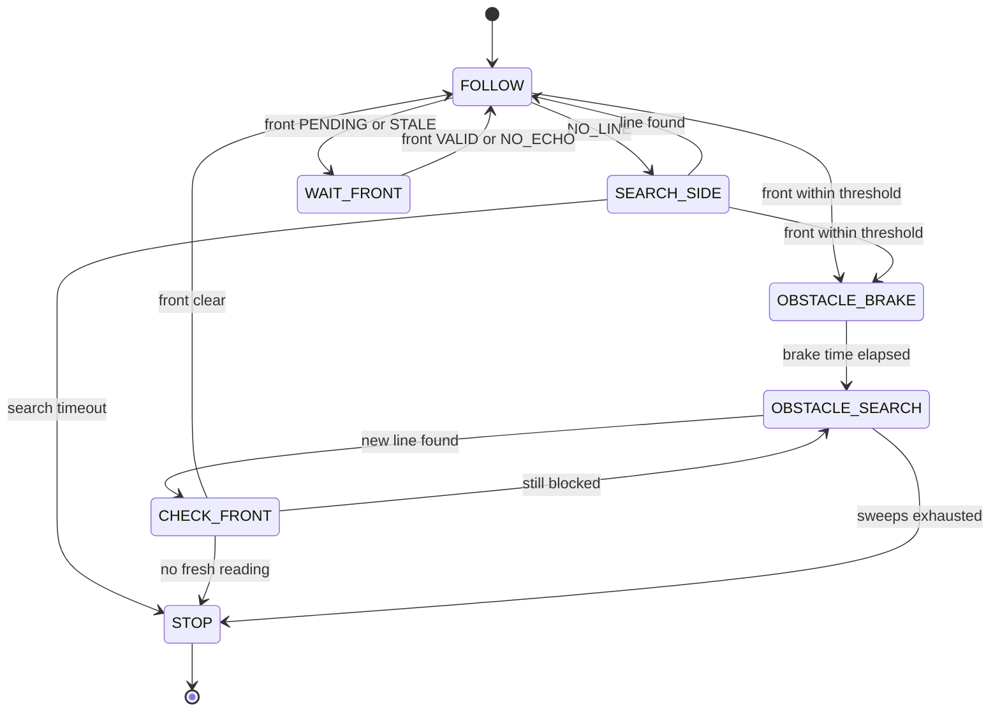

# Robot Firmware Overview (`src/`)

MicroPython firmware for the Raspberry Pi Pico line-following robot: two digital IR
line sensors, two HC-SR04 ultrasonic sensors (front and left), and two DC motors
driven by an L298N.

| File | Role | Upload to Pico? |
|---|---|---|
| [`main.py`](main.py) | Line-following controller, lost-line search, obstacle handling, main loop | Yes (upload last; runs on boot) |
| [`motor.py`](motor.py) | Signed PWM control of the two wheels | Yes |
| [`ir_sensors.py`](ir_sensors.py) | IR sampling, debouncing and line-state classification | Yes |
| [`ultrasonic.py`](ultrasonic.py) | Non-blocking front/left distance measurement | Yes |
| [`ir_calibration.py`](ir_calibration.py) | Prints raw IR levels for calibration | Only when calibrating |

All modules are non-blocking: the main loop polls each sensor every ~1 ms, and no
control function sleeps.

---

## Pin Map

| Function | GPIO |
|---|---|
| Left motor IN1 / IN2 / ENA (PWM) | GP2 / GP3 / GP4 |
| Right motor IN3 / IN4 / ENB (PWM) | GP6 / GP7 / GP8 |
| Front ultrasonic TRIG / ECHO | GP10 / GP11 |
| Left ultrasonic TRIG / ECHO | GP12 / GP13 |
| Left IR OUT / Right IR OUT | GP14 / GP15 |

Remove the ENA/ENB jumpers, share a common ground, and fit a 1 kΩ / 2 kΩ divider on
each Echo line.

---

## `motor.py` — Wheel Control

Importing the module does **not** touch any pins; motors start only after
`init_motors()`.

| API | Behaviour |
|---|---|
| `init_motors()` | Creates both PWM channels (1 kHz) at zero duty and the four direction pins; motors stay stopped. |
| `drive(left_percent, right_percent)` | Signed command per wheel, clamped to −100…100. Negative reverses the wheel (used for pivots). `0` disables that channel, so the wheel **coasts** (no active braking). Repeated identical commands are ignored. Both enables are set to 0 before any direction change to avoid shoot-through glitches. |
| `stop()` | Zero duty on both channels and all direction pins LOW. Also called on exit. |
| `main()` | Standalone test: runs the left, then the right motor forward for `RUN_SECONDS`. |

Configuration: `LEFT_FORWARD` / `RIGHT_FORWARD` (swap `(1, 0)` ↔ `(0, 1)` if a wheel
runs backwards), `PWM_FREQUENCY`.

> Duty is a drive command, not a measured speed. Actual speed depends on battery
> voltage and load.

---

## `ir_sensors.py` — Line Sensing

Two digital IR modules. Calibrated levels: **black tape = 1, background = 0**.
The controller assumes **both probes sit on the tape when the robot is centred**.

### Processing

1. `update_ir()` reads both pins at most every `SAMPLE_INTERVAL_MS` (5 ms).
2. A new pattern becomes the confirmed state only after `CONFIRM_SAMPLES` (3)
   identical consecutive samples (≈10–15 ms).
3. Confirmed patterns map to states:

| (left black, right black) | State | Meaning |
|---|---|---|
| (1, 1) | `BOTH_BLACK` | Centred on the line (also at crossings) |
| (1, 0) | `LINE_LEFT` | Line is under the left probe → robot drifted right |
| (0, 1) | `LINE_RIGHT` | Line is under the right probe → robot drifted left |
| (0, 0) | `NO_LINE` | Line lost, corner overshoot, gap or line end |
| — | `UNSTABLE` | No confirmed state yet (after init) |

4. **Raw side memory:** any *single* raw sample with only one probe on black
   immediately updates `last_seen_side` / `last_side_ms`, even if it was never
   confirmed. This captures the turn direction when the robot leaves a sharp
   corner faster than the debounce window.

### API and snapshot

| API | Behaviour |
|---|---|
| `init_ir(left_black_level=None, right_black_level=None)` | Sets black polarity and resets filtering. |
| `update_ir(now_ms=None)` | Takes one sample if due; returns `True` when a sample was taken. |
| `get_ir_snapshot()` | Returns a copy of the latest snapshot (does not read GPIO). |
| `read_raw_ir()` | Returns raw `(left, right)` pin values. |

Snapshot fields: `timestamp_ms`, `raw`, `black`, `state`, `state_duration_ms`,
`last_seen_side`, `last_side_ms`, `line_missing` (confirmed `NO_LINE` for ≥
`LINE_MISSING_MS` = 100 ms), `state_changed` (true only on the update that changed
the state).

### `ir_calibration.py`

Prints raw `LEFT | RIGHT` values every 200 ms. Place each probe over the tape and
over every background colour, then set `LEFT_BLACK_LEVEL` / `RIGHT_BLACK_LEVEL`.

---

## `ultrasonic.py` — Distance Sensing

Non-blocking HC-SR04 driver using hardware pin interrupts on the Echo lines.

- Front and left sensors are triggered **alternately**, one trigger every
  `ASYNC_TRIGGER_GAP_MS` (70 ms), so each sensor updates about every 140 ms.
- The IRQ only records rising/falling timestamps; distance
  (`pulse_us × 0.0343 / 2` cm) is computed in `update_ultrasonic()`.
- An Echo longer than `ECHO_TIMEOUT_US` (30 ms) is a timeout.

| API | Behaviour |
|---|---|
| `init_async()` | Resets readings and attaches both Echo IRQs. |
| `update_ultrasonic(now_ms=None)` | Completes a pending reading or sends the next due trigger. Never waits for an Echo. |
| `get_ultrasonic_snapshot(now_ms=None)` | Returns `front_*` and `left_*` fields: `_cm`, `_status`, `_age_ms`, `_sample_ms` (trigger time of that reading). |
| `close_async()` | Detaches IRQs and drives both triggers LOW. |

| Status | Meaning |
|---|---|
| `PENDING` | No reading yet since init |
| `VALID` | Echo received; `_cm` holds the distance |
| `NO_ECHO` | Timed out (nothing in range) |
| `STALE` | Last reading older than `MAX_READING_AGE_MS` (300 ms) |

---

## `main.py` — Controller

### Main loop

```text
init_motors() → init_ir() → init_async() → reset_tracking() → wait 3 s
loop every ~1 ms:
    update_ultrasonic(now)
    if update_ir(now):                      # a new IR sample (every 5 ms)
        mode = update_robot(ir_snapshot, sonar_snapshot, now)
        print state/mode when they change
on Ctrl+C or any error: motor.stop(), close_async()
```

### Decision priority — `update_robot()`

1. Latched `STOP` → stay stopped.
2. Obstacle search active → continue `_search_side_line()`.
3. Front distance unknown (`PENDING` / `STALE`) → stop, return `WAIT_FRONT`.
   `NO_ECHO` is treated as clear (`CLEAR_DISTANCE_CM` = 999 cm).
4. Front distance ≤ `OBSTACLE_DISTANCE_CM` → start obstacle search.
5. Otherwise → `update_tracking()` (line following / lost-line search).

### Line following — `follow_line()`

Bang-bang steering from the confirmed IR state:

| State | Left, Right drive |
|---|---|
| `BOTH_BLACK` | `BASE_SPEED_PERCENT`, `BASE_SPEED_PERCENT` |
| `LINE_LEFT` | `TURN_INNER_PERCENT`, `BASE_SPEED_PERCENT` (turn left) |
| `LINE_RIGHT` | `BASE_SPEED_PERCENT`, `TURN_INNER_PERCENT` (turn right) |
| other | stop |

Crossroads read as `BOTH_BLACK`, so the robot drives straight through them.

### Lost-line search — `update_tracking()`

When the confirmed state becomes `NO_LINE` in `FOLLOW` mode:

1. **Choose the first side:** the most recent single-probe side (confirmed state or
   raw transient) seen within `DIRECTION_MEMORY_MS` (500 ms); otherwise
   `DEFAULT_SEARCH_SIDE` (`"RIGHT"`).
2. **Sweep:** turn toward that side for `SEARCH_FIRST_SWEEP_MS` (600 ms), then toward
   the opposite side until `SEARCH_TIMEOUT_MS` (1800 ms) from the start of the search.
   The sweep drives the outer wheel at `SEARCH_SPEED_PERCENT` and the inner wheel at
   `SEARCH_INNER_PERCENT` (slight reverse) for a tighter turn.
3. **Recover** without stopping when either `BOTH_BLACK` or the probe on the *current*
   sweep side sees the line; direction memory is cleared and normal following
   resumes. Opposite-side readings are ignored during a sweep.
4. **Timeout** → latched `STOP` (e.g. at a FINISH line end). Only a restart or
   `reset_tracking()` clears it.

### Obstacle handling — `_search_side_line()`

Triggered when the front distance is ≤ `OBSTACLE_DISTANCE_CM`.

1. **Direction:** pivot `RIGHT` if the left sensor also sees something within the
   threshold, otherwise `LEFT`.
2. `OBSTACLE_BRAKE` for `OBSTACLE_BRAKE_MS`.
3. Pivot in place (`±OBSTACLE_TURN_PERCENT`) for `OBSTACLE_FIRST_SWEEP_MS`; then brake
   and pivot the other way for `OBSTACLE_SECOND_SWEEP_MS`.
4. A line counts only after the probes have first **left** the original line
   (`NO_LINE`) and then see `BOTH_BLACK` again.
5. `CHECK_FRONT`: stop and wait for a **new** front reading taken at least
   `OBSTACLE_BRAKE_MS` after the line was found. If it is clear, resume `FOLLOW`;
   if still blocked, keep pivoting; if no usable reading within
   `FRONT_CHECK_TIMEOUT_MS`, latch `STOP`.
6. Both sweeps exhausted or `OBSTACLE_TOTAL_TIMEOUT_MS` exceeded → latch `STOP`.

### Mode summary



`SEARCH_SIDE` stands for `SEARCH_LEFT` / `SEARCH_RIGHT`; `OBSTACLE_SEARCH` stands for
`OBSTACLE_SEARCH_LEFT` / `OBSTACLE_SEARCH_RIGHT`.

### Tunable parameters

| Constant | Default | Purpose |
|---|---|---|
| `BASE_SPEED_PERCENT` | 60 | Forward drive on the line |
| `TURN_INNER_PERCENT` | 0 | Inner wheel while correcting (0 = coast) |
| `SEARCH_SPEED_PERCENT` | 50 | Outer wheel during lost-line search |
| `SEARCH_INNER_PERCENT` | −25 | Inner wheel during lost-line search |
| `SEARCH_FIRST_SWEEP_MS` | 600 | First sweep duration |
| `SEARCH_TIMEOUT_MS` | 1800 | Total lost-line search time before `STOP` |
| `DEFAULT_SEARCH_SIDE` | `"RIGHT"` | First sweep side without direction memory |
| `DIRECTION_MEMORY_MS` | 500 | Validity of a remembered side |
| `CLEAR_DISTANCE_CM` | 999.0 | Distance used for `NO_ECHO` |
| `OBSTACLE_DISTANCE_CM` | 5 | Front obstacle threshold |
| `OBSTACLE_TURN_PERCENT` | 45 | Pivot drive during obstacle search |
| `OBSTACLE_BRAKE_MS` | 100 | Brake time / minimum age of a fresh reading |
| `OBSTACLE_FIRST_SWEEP_MS` | 1000 | First obstacle pivot |
| `OBSTACLE_SECOND_SWEEP_MS` | 2000 | Return pivot across the original heading |
| `OBSTACLE_TOTAL_TIMEOUT_MS` | 5000 | Total obstacle search time |
| `FRONT_CHECK_TIMEOUT_MS` | 500 | Wait for a fresh front reading |

---

## Calibration Notes and Known Limitations

- **Turns are time-based.** Sweep and pivot durations are not angles; measure the
  time for 90° and 180° on the real robot (and re-check as batteries drain).
- **Motor dead band:** low duties (e.g. the −25 % search inner wheel) may not move a
  wheel on 4×AA through the L298N; verify with raised wheels.
- **IR geometry and backgrounds:** confirm both probes fit inside the tape, and
  calibrate on every surface (white, red/green ramp, blue foam, wood, glossy tape).
- **Ultrasonic latency:** front readings arrive about every 140 ms, and the 5 cm
  threshold is close to the HC-SR04 minimum range; low obstacles may be missed if
  the sensor is mounted high. `NO_ECHO` is treated as clear, so a disconnected Echo
  line is not detected.
- **Latched `STOP`:** any search timeout stops the robot until restart.
- Not yet handled: crossing a gap between separate line segments, Y-junction branch
  selection, and reliable 180° turnarounds at dead ends.

## Testing

Host-side tests simulate the Pico `machine` and `time` modules:

```bash
python3 -B -m unittest discover -s tests
```
